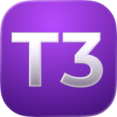

<p align="center">
  <a href="https://github.com/Skyway1111/no-deps-T3">
    
  </a>
</p>

<h1 align="center">no-deps-T3</h1>

<p align="center">
  <strong>A for-fun experimental fork of <a href="https://github.com/pingdotgg/t3code">T3 Code</a></strong> — tearing out 100+ runtime dependencies and replacing them with hand-rolled zero-dependency TypeScript and zero-crate Rust engines.
</p>

> [!NOTE]
> **This is a for-fun personal experiment, not an official T3 Code release.**
> Looking for the real thing? Grab the official builds from [t3.codes](https://t3.codes) or [pingdotgg/t3code](https://github.com/pingdotgg/t3code).

## What is this experiment?

We wanted to see how far we could push a real, multi-surface production app (web, desktop, server, and mobile) when we replace heavy third-party packages with small, purpose-built engines in-tree — and then ruthlessly profile and optimize every hot path across startup, memory, long threads, streaming, rendering, and native I/O.

What changed compared to upstream [pingdotgg/t3code](https://github.com/pingdotgg/t3code):

- **102 runtime dependencies removed** (`210 → 108` unique production packages workspace-wide; the remaining ones are mostly Expo/React Native mobile packages, React, Effect, agent provider SDKs, and Electron packaging). Zero third-party UI, diff, file-tree, icon, or syntax-highlighting libraries remain in the web bundle.
- **Zero-dependency TypeScript engines built in-tree:**
  - **UI & state:** custom UI primitives, popups, combobox, virtual list (Fenwick-tree sizing), light-DOM fixed-height file tree + 58 vendored file-icon symbols (replacing `@pierre/trees` + Preact), drag-and-drop, router, and Zustand-compatible signal/persist store.
  - **Diffs, code viewing, editing & syntax highlighting:** light-DOM virtualized `CodeView`, `FileDiff`, `File`, and inline `Editor` (~5.2k LOC replacing the 40.5k-line `@pierre/diffs` + Shiki/Oniguruma stack), Hermes-safe pure-TS `charCodeAt` syntax highlighter (~70 languages, `pierre-dark` / WCAG-checked `t3-light`, Zed + TextMate themes, replacing `@pierre/highlights` + the mobile `wasm2c`/Nitro C++ module), and unified patch parser/hydrator.
  - **Rich content & previews:** custom Markdown parser/HAST emitter/sanitizer, Mermaid layout & SVG renderer, TipTap-free rich-text composer, PDF renderer, Office (DOCX/XLSX/PPTX) worker engine, TIFF/HEIC image decoders, WebGL 3D device preview renderer, React 18/19 fiber inspector (replacing `react-grab`), and vendored Inter Variable font.
  - **Core & protocols:** `node:sqlite` worker pool, histogram/Myers diff, linear JSONC/YAML/XML/D-Bus parsers, and direct CDP browser automation.
- **Zero-crate Rust native binaries:**
  - `native/t3-desktop` — standalone WebKitGTK desktop shell (`0.67 MB` stripped release binary).
  - `native/t3-sys` — unified native PTY bridge, fuzzy workspace search/grep daemon, macOS `clonefile`, Windows registry/foreground/hotkey syscalls (replacing `ffi-rs`), and OS helpers (`689 KB`).
  - `native/resource-monitor` — zero-clone system resource history monitor.
- **Isolated local run:** custom purple branding, isolated `~/.no-deps-t3` state directory (does not touch your real `~/.t3` install), and a native launcher at [`scripts/launch-no-deps-t3.mjs`](./scripts/launch-no-deps-t3.mjs).

## Benchmarks

### 1. Zero-dependency engine replacement vs upstream libraries

When swapping out the original 97 runtime packages for our in-tree TS and Rust engines:

- **32 / 32** head-to-head engine benchmarks green with a **3.41× geometric mean speedup** over the replaced npm libraries.
- Custom PDF engine matched `pdf.js 6.5` within **0.00–0.53 px** across full Type1/CFF/OpenType font reconstruction, CMaps, shadings, and transparency groups.

### 2. Removing `@pierre/*` (diffs, trees, highlights, Shiki/Oniguruma), `ffi-rs` & quick wins

Replacing `@pierre/diffs`, `@pierre/trees` (Preact + Shadow DOM), `@pierre/highlights` (plus mobile's `wasm2c`/`simde`/Nitro C++ module), `ffi-rs`, `@clerk/electron-passkeys`, `react-grab`, and `@fontsource-variable/inter` cut **−178,311 net LOC** across 242 files with **377/377 tests** and `vp run knip:check` passing:

| Benchmark                                       |           Before |                  After |                 Change |
| ----------------------------------------------- | ---------------: | ---------------------: | ---------------------: |
| `apps/web/dist` total JS (non-map)              |         34.07 MB |           **18.68 MB** |  **−45.2% (−15.4 MB)** |
| `apps/web/dist` JS chunks / transformed mods    | 850 / 3,353 mods |   **353 / 2,523 mods** |      **−58.5% chunks** |
| FileTree chunk (raw / gzipped)                  | 197.3 / 54.0 KiB |     **24.3 / 8.8 KiB** |       **8.1× smaller** |
| Inter Variable font assets                      |     1,196 KB pkg |             **221 KB** |       **5.4× smaller** |
| 100-file diff first render (Chromium)           |           260 ms |              **52 ms** |        **5.0× faster** |
| `DiffFileTree` mount (2,000 files, Chromium)    |       22–23.5 ms |         **10–10.5 ms** |        **2.2× faster** |
| `DiffFileTree` expand all (1,200 dirs, browser) |         73–75 ms |         **2.8–3.7 ms** |        **~22× faster** |
| `DiffFileTree` collapse all (browser)           |            64 ms |         **2.4–2.9 ms** |        **~24× faster** |
| Streaming highlight (1 char/step, 300 lines)    |          23.8 ms |             **7.5 ms** |        **3.2× faster** |
| `parsePatchFiles` (11 MB, 150 commits)          | 116 ms (95 MB/s) | **50.5 ms (218 MB/s)** |        **2.3× faster** |
| `hydratePartialDiff`                            |          0.38 ms |            **0.06 ms** |        **6.2× faster** |
| `t3-sys` Linux release binary (+3 OS commands)  |         686.9 KB |           **689.5 KB** | **+2.7 KB (0 crates)** |

### 3. Optimization & cleanup pass (zero-dep base → optimized engines)

After reaching feature parity, we ran a 6-workstream optimization pass across server, client state, web UI, composer/decoders/WebGL, native Rust/parsers/CDP, and boot/bundle splitting, followed by a dead-code cleanup pass (**−29,540 net LOC** across 343 files; `vp run knip:check` 100% clean).

#### Startup, memory & bundle footprint

| Benchmark                                           |              Before |                   After |              Change |
| --------------------------------------------------- | ------------------: | ----------------------: | ------------------: |
| `t3 --version` wall time (hyperfine, 20 runs)       |              356 ms |            **61–68 ms** | **5.3–5.8× faster** |
| `t3 --version` peak RSS                             |              158 MB |               **55 MB** |        **−65% RSS** |
| Server cold import (`binCli` + `server`), median    | 642 ms · 239 MB RSS | **575 ms · 218 MB RSS** |      **−21 MB RSS** |
| `t3-desktop` Rust release binary (thin LTO + strip) |             5.15 MB |             **0.67 MB** |    **7.7× smaller** |
| `_chat.tsx` route assets (device stack lazy-loaded) |             13.9 MB |              **2.1 MB** |     **−85% assets** |
| Opaque decoded image previews (JPEG 0.92 vs PNG)    |              9.1 MB |             **0.91 MB** |     **10× smaller** |

#### Server, native Rust, diff, parsers & CDP

| Benchmark                                      |                          Before |                               After |                         Change |
| ---------------------------------------------- | ------------------------------: | ----------------------------------: | -----------------------------: |
| Wire framing `encodeFrame` (2 MB payload)      | 0.72 ms · 2,791 MB/s (3.0× buf) | **0.25 ms · 7,902 MB/s (1.0× buf)** |  **2.8× faster · 3× less mem** |
| `KeyedCoalescingWorker` enqueue (queue vs STM) |                           38 µs |                            **1 µs** |                **~38× faster** |
| SQLite event replay (20,000 events)            |                    873–1,211 ms |                      **543–739 ms** |               **~1.6× faster** |
| SQLite event writes (batches of 50)            |                1,855–1,965 ev/s |                **2,421–2,613 ev/s** |               **~1.3× faster** |
| PTY `kill` under output flood (stalled reader) |                       >1,500 ms |                           **<1 ms** |             **>1,500× faster** |
| Terminal sanitizer (8 MiB unterminated OSC)    |                        3,097 ms |                          **0.5 ms** |             **~6,200× faster** |
| Fuzzy watcher `.git` touch rescan cost         |                        1,560 ms |                            **0 ms** |                 **eliminated** |
| CDP accessibility snapshot (1,500-item page)   |                      6,005 RPCs |                          **2 RPCs** |          **3,000× fewer RPCs** |
| Histogram diff `structuredPatch` (50k lines)   |                        23.46 ms |                         **4.36 ms** |                **5.4× faster** |
| Word diff (10k tokens, bounded Myers fallback) |               515 ms · +392 MiB |                 **53 ms · +17 MiB** | **9.7× faster · 23× less mem** |
| `parseJsonc` (50k entries w/ trailing commas)  |                       14,800 ms |                           **34 ms** |                **435× faster** |
| Streaming XML parser (8 MiB in 16 KiB chunks)  |                          700 ms |                          **5.6 ms** |                **125× faster** |

#### Client state, streaming, timeline, composer & WebGL

| Benchmark                                      |                            Before |                             After |                               Change |
| ---------------------------------------------- | --------------------------------: | --------------------------------: | -----------------------------------: |
| `signal.persist()` (400 no-op / transient ops) |   5.81 ms · 400 writes · 2,038 KB |    **0.45 ms · 1 write · 5.1 KB** | **12.9× faster · 400× fewer writes** |
| Streaming `message.updated` (1k-item thread)   | 209–231 µs/delta · 12k recomputes | **60–64 µs/delta · 0 recomputes** |                      **3.5× faster** |
| Sidebar parent-child lookup (500 threads)      |                  26,500 env scans |           **500 indexed lookups** |                    **53× less work** |
| Long timeline (500 turns, 40 tool appends)     |                          207.4 ms |                       **80.9 ms** |                      **2.6× faster** |
| Composer typing (25 KB / 100 paragraphs)       |    3.3–3.6 ms · 378 DOM mutations |   **1.1–1.6 ms · 1 DOM mutation** |                     **~2.5× faster** |
| Combobox filter (1,000 items × 5 queries)      |                            5.7 ms |                       **0.34 ms** |                     **16.8× faster** |
| Mermaid dense graph layout (60 nodes)          |                          13.92 ms |                       **8.84 ms** |                      **1.6× faster** |
| WebGL 3D phone preview (streamed frame)        |                528 GL calls/frame |            **308 GL calls/frame** |                    **−42% GL calls** |

## Running this fork locally

```bash
vp i
vp run dev
```

Or launch the standalone WebKitGTK desktop shell (Linux) against an isolated `~/.no-deps-t3` home:

```bash
node scripts/launch-no-deps-t3.mjs
```

---

## Upstream: T3 Code

<p align="center">The open-source control plane for coding agents.</p>

<p align="center">
  <a href="https://t3.codes/download"><strong>Download</strong></a> ·
  <a href="https://apps.apple.com/us/app/t3-code-remote-claude-more/id6787819824">iOS</a> ·
  <a href="https://play.google.com/store/apps/details?id=com.t3tools.t3code">Android</a> ·
  <a href="https://app.t3.codes">Web</a> ·
  <a href="./docs/README.md">Docs</a> ·
  <a href="https://discord.gg/jn4EGJjrvv">Discord</a>
</p>

<p align="center">
  <a href="https://t3.codes">
    
  </a>
</p>

T3 Code runs the coding agents on your machine and gives them one fast interface. Start a thread at your desk, then approve the next step from your phone.

It works with Claude Code, Codex, Cursor, OpenCode, Grok Build, Antigravity, Kiro, Pi, Muse Code, fx, and any [ACP](./docs/user/providers-acp.md) agent. If an agent is set up on your computer, T3 Code can control it.

## What you get

- **Your subscriptions.** T3 Code does not resell tokens. It drives the agents you are already signed in to.
- **Every agent in one place.** Change models in the middle of a thread. Let Claude hand a task to Codex.
- **Desktop, web, and phone.** One server, and every client shows the same threads. There are apps for iOS and Android.
- **Remote ready.** Run agents on any machine. Connect over your local network, Tailscale, or [T3 Connect](./docs/user/remote-access.md).
- **Git built in.** Each thread can work in its own worktree. Review the diff, then commit, push, and open a pull request with one button.
- **Fast.** Performance is a feature here. We measure it, and we treat a dropped frame as a bug.
- **Open.** MIT licensed. If you don't like something, fork it.

## Install

### Desktop app

[Download T3 Code](https://t3.codes/download) for macOS, Windows, or Linux. You can also use a package manager:

| Platform       | Command                                                              |
| -------------- | -------------------------------------------------------------------- |
| macOS          | `brew install --cask t3-code`                                        |
| Windows        | `winget install T3Tools.T3Code` or `scoop install extras/t3code`     |
| Arch Linux     | `yay -S t3code-bin`                                                  |
| Nix            | `nix profile add github:NixOS/nixpkgs/nixos-unstable#t3code`         |
| Debian, Ubuntu | `.deb` from [Releases](https://github.com/pingdotgg/t3code/releases) |

### Command line

This installs the `t3` command. Run `t3` to start the server and open the web app.

```bash
curl -fsSL https://t3.codes/install.sh | sh
```

On Windows, in PowerShell:

```powershell
irm https://t3.codes/install.ps1 | iex
```

To try it once without an install, run `npx t3@latest`.

### Phone

Get the app from the [App Store](https://apps.apple.com/us/app/t3-code-remote-claude-more/id6787819824) or [Google Play](https://play.google.com/store/apps/details?id=com.t3tools.t3code). Then follow [remote access](./docs/user/remote-access.md) to connect it to your computer.

### Sign in to an agent

T3 Code needs one agent that is installed and signed in. For example, install [Claude Code](https://claude.com/product/claude-code) and run `claude auth login`, or install [Codex CLI](https://developers.openai.com/codex/cli) and run `codex login`.

[Provider setup](./docs/user/install.md#providers) has the steps for each agent. [Install T3 Code](./docs/user/install.md) covers nightly builds, AppImage, WSL, and NixOS.

## "Wait, what are you selling me?"

Nothing. We built T3 Code because we wanted the best possible development experience with agents. We were inspired by existing solutions like the Codex desktop app, Conductor, Claude Desktop and Cursor Glass, but none met our bar.

We wanted something performant, remote-ready, and truly open. If we ever go the wrong direction, we want you to have everything you need to fork and build the tool that you want.

## Documentation

- [Install and first run](./docs/user/install.md)
- [Remote access from a phone or another machine](./docs/user/remote-access.md)
- [Permission modes](./docs/user/permission-modes.md)
- [Source control](./docs/user/source-control.md)
- [Connect outside agents over MCP](./docs/user/outside-agents.md)
- [FAQ](./docs/user/faq.md)

[All docs](./docs/README.md) has the full list.

## Contributing

We have limited review capacity. Small, focused fixes are the most likely to be merged. Features need an approved discussion first.

- Read [CONTRIBUTING.md](./CONTRIBUTING.md) before you report a bug or open a pull request.
- Put feature requests in [Ideas](https://github.com/pingdotgg/t3code/discussions/categories/ideas).
- Build from source with the [development runbook](./docs/operations/development.md#first-checkout). The [architecture overview](./docs/internals/overview.md) explains how it works.
- Get help in [Discord](https://discord.gg/jn4EGJjrvv).

## License

[MIT](./LICENSE)
